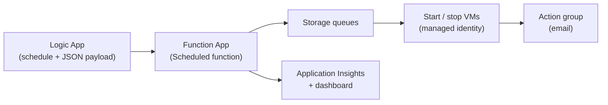

# Start/Stop VMs v2 (User Guide)

Start/Stop VMs v2 automatically starts and stops Azure VMs on schedules you define, to reduce compute cost. This guide covers a **central deployment** that manages VMs across a **subscription** and uses **VM tags** to control which VMs are affected.

Official documentation: https://docs.microsoft.com/azure/azure-functions/start-stop-vms/overview

**Contents**

1. [Overview](#1-overview)
2. [Deploy](#2-deploy)
3. [Configure (subscription scope, tags and schedules)](#3-configure-subscription-scope-tags-and-schedules)
4. [Manage and monitor](#4-manage-and-monitor)
5. [Appendix](#appendix)

---

# 1. Overview

## What it does

- Starts and stops VMs on a schedule (daily, weekly, custom).
- Targets VMs by subscription, resource group, or explicit VM list, with exclusions.
- Reports activity to Application Insights and a ready-made Azure dashboard.
- Sends optional email notifications through an Azure Monitor action group.

## How it works



| Component | Role |
| --- | --- |
| **Logic Apps** | Hold the schedule (Recurrence trigger) and the JSON payload that says *what* to start or stop. |
| **Function App** | Receives the payload and starts or stops the VMs using its managed identity. |
| **Storage account** | Stores operation history and queues work items. |
| **Application Insights** | Stores logs, metrics and powers the dashboard. |
| **Action group** | Sends email notifications (`StartStopV2_VM_Notification`). |

## Logic Apps created by default

| Logic App | Purpose |
| --- | --- |
| `ststv2_vms_Scheduled_start` | Starts VMs on a schedule. **Used in this guide.** |
| `ststv2_vms_Scheduled_stop` | Stops VMs on a schedule. **Used in this guide.** |
| `ststv2_vms_Sequenced_start` / `_stop` | Starts or stops VMs in a defined order using tags. See [Appendix](#a3-sequenced-start-and-stop). |
| `ststv2_vms_AutoStop` | Stops VMs with low CPU. See [Appendix](#a4-auto-stop-on-low-cpu). |

## Prerequisites

- An Azure subscription for the central deployment.
- **Owner** permission on that subscription (needed to deploy).
- A region that supports Azure Functions. For the zone-redundant plan, see the [supported regions](#zone-redundant-plan-regions).

> **Note:** Microsoft has stated that no further feature development is planned for Start/Stop VMs v2 other than updates required to stay on supported components. See the [official documentation](https://docs.microsoft.com/azure/azure-functions/start-stop-vms/overview).

---

# 2. Deploy

Deploy once into a **central subscription**, in a **dedicated resource group**. Doing so makes the solution easy to manage and remove.

## Step 1: Choose a plan

| Plan | What is deployed | When to use |
| --- | --- | --- |
| **StartStopV2** (default) | Function App Consumption plan and locally redundant storage. | Most scenarios. Lowest cost. |
| **StartStopV2-AZ** | Availability zone-enabled Function App Elastic Premium plan (minimum 3 instances) and zone-redundant storage. | You need zone resiliency. |

## Step 2: Deploy to Azure

Sign in to the Azure portal if prompted.

<a href="https://portal.azure.com/#create/microsoftcorporation1620879115842.startstopv2startstopv2-08252021" target="_blank">
  
</a>

## Step 3: Fill in the deployment form

1. Select the **Plan** (see Step 1).
2. Select **Create**.
3. Enter the values below.

| Field | Value |
| --- | --- |
| Region | Region for the new resources. |
| Resource Group Name | Name of the dedicated resource group, for example `rg-startstopv2`. |
| Resource Group Region | Region of that resource group. |
| Azure Function App Name | A name that is unique in Azure Functions. A random suffix is appended automatically. |
| Application Insights Name | Name of the Application Insights instance. |
| Application Insights Region | Region of Application Insights. |
| Storage Account Name | Name of the storage account. A random suffix is appended automatically. |
| Email Address | One or more addresses (comma-separated) for notifications. |

4. Select **Review + create**, then **Create**.
5. When the deployment finishes, select **Go to resource group** and confirm that the Function App, five Logic Apps, Application Insights, storage account and action group are present.

> **Note:** Existing storage accounts and Application Insights instances cannot be reused.
>
> **Policy note:** Deployment tags the resource group and its resources with `SolutionName=StartStopV2` and removes other tags on them. If you have an Azure Policy that denies changes based on tags, allow resources that carry only this tag.
>
> **Security note:** Anyone who can modify this solution can create start and stop operations for every VM in its scope, even without permissions on those VMs. Anyone with access to its Application Insights can see operation history. Restrict access to the resource group accordingly.

#### Zone-redundant plan regions

When using **StartStopV2-AZ**, deploy to one of: Australia East, Brazil South, Canada Central, Central US, East US, East US 2, France Central, Germany West Central, Japan East, North Europe, Southeast Asia, UK South, West Europe, West US 2, West US 3.

---

# 3. Configure (subscription scope, tags and schedules)

The configuration has three parts:

1. **Scope**: the subscription the solution acts on.
2. **Tags**: which VMs to include or exclude.
3. **Schedules**: when to stop and start.

## 3.1 Understand how tags work

At subscription scope, the solution targets **every VM** in the subscription, including VMs with no tag. Use the `ssv2excludevm` tag to control individual VMs:

| Tag | Value | Effect |
| --- | --- | --- |
| `ssv2excludevm` | `false` | VM is **included** in start and stop actions. |
| `ssv2excludevm` | `true` | VM is **excluded** from start and stop actions. |
| *(no tag)* | n/a | VM is **included**, same as `false`. |
| `sequencestart` / `sequencestop` | Number 1..N | VM is started or stopped in that order. Only used by the [Sequenced](#a3-sequenced-start-and-stop) Logic Apps. |

Recommended approach for a central deployment:

- Tag any VM that must never be touched with `ssv2excludevm=true`.
- Optionally tag VMs you want managed with `ssv2excludevm=false` to make the intent explicit.

> **Important:** New VMs created in the subscription are targeted automatically unless they carry `ssv2excludevm=true`. Consider an Azure Policy that applies the exclude tag by default to sensitive workloads.

### Tag a VM (portal)

1. Open the VM in the Azure portal.
2. Select **Tags**.
3. Add name `ssv2excludevm` with value `false` (include) or `true` (exclude).
4. Select **Apply**.

### Tag VMs at scale (Azure CLI)

```bash
az tag update \
  --resource-id "/subscriptions/<subscription-id>/resourceGroups/<rg>/providers/Microsoft.Compute/virtualMachines/<vm-name>" \
  --operation Merge \
  --tags ssv2excludevm=false
```

For large estates, tag by using the **Tags** blade bulk assignment or an Azure Policy that applies the tag.

## 3.2 Configure the subscription scope

Each Logic App holds a JSON payload. Set the same scope in both the stop and start Logic Apps.

1. In the Azure portal, open **Logic apps** and select `ststv2_vms_Scheduled_stop`.
2. Select **Logic app designer**.
3. Select **Function-Try**.
4. Replace the request body with the following. Replace the subscription ID with your own and keep the trailing `/`.

```json
{
  "Action": "stop",
  "EnableClassic": false,
  "RequestScopes": {
    "ExcludedVMLists": [],
    "Subscriptions": [
      "/subscriptions/<your-subscription-id>/"
    ]
  }
}
```

5. Select **Save**.
6. Repeat on `ststv2_vms_Scheduled_start` with `"Action": "start"`.

Notes:

- Leave `ExcludedVMLists` empty to control VMs with the `ssv2excludevm` tag. You may also add VM resource paths or wildcards such as `"Az*"` there.
- Keep `EnableClassic` as `false` unless you still have classic VMs.

## 3.3 Configure the schedule

The schedule is set in the **Recurrence** trigger at the top of each Logic App.

### Example: stop Friday 8 PM, start Monday 6 AM

**Stop Logic App** (`ststv2_vms_Scheduled_stop`)

1. Open **Logic app designer** and select **Recurrence**.
2. Set:

| Field | Value |
| --- | --- |
| Interval | `1` |
| Frequency | `Week` |

3. Select **Add new parameter** and add **On these days**, **At these hours**, **At these minutes**, **Time zone** and **Start time**.
4. Set:

| Field | Value |
| --- | --- |
| On these days | `Friday` |
| At these hours | `20` |
| At these minutes | `0` |
| Time zone | `(UTC+10:00) Canberra, Melbourne, Sydney` (AEST) |
| Start time | A date and time in the future, for example `2026-10-23T00:00:00` |

5. Select **Save**.

**Start Logic App** (`ststv2_vms_Scheduled_start`)

Same steps, with:

| Field | Value |
| --- | --- |
| Interval | `1` |
| Frequency | `Week` |
| On these days | `Monday` |
| At these hours | `6` |
| At these minutes | `0` |
| Time zone | `(UTC+10:00) Canberra, Melbourne, Sydney` (AEST) |
| Start time | A date and time in the future |

> **Important:** Always set **Start time** in the future. If it is blank, the Logic App runs immediately when saved and may start or stop VMs unexpectedly.

> **Tip:** You can edit the Recurrence in **Code view** instead. The Friday 8 PM stop trigger looks like this:
>
> ```json
> "recurrence": {
>   "frequency": "Week",
>   "interval": 1,
>   "schedule": {
>     "weekDays": [ "Friday" ],
>     "hours": [ "20" ],
>     "minutes": [ 0 ]
>   },
>   "startTime": "2026-10-23T00:00:00",
>   "timeZone": "AUS Eastern Standard Time"
> }
> ```
>
> `timeZone` uses Windows time zone names. `AUS Eastern Standard Time` is AEST and follows daylight saving (AEDT) automatically. For Queensland, which has no daylight saving, use `E. Australia Standard Time`.

### Enable the Logic Apps

1. Open each Logic App.
2. On the **Overview** page, select **Enable**.

### More schedule examples

| Goal | Frequency | Days | Hours / minutes |
| --- | --- | --- | --- |
| Stop every weekday evening | Week | Monday to Friday | `19` / `0` |
| Start every weekday morning | Week | Monday to Friday | `7` / `0` |
| Stop every night | Day | n/a | `22` / `0` |
| Start every morning | Day | n/a | `6` / `30` |
| Stop on Friday, start on Monday | Week | Friday (stop), Monday (start) | `20` / `0` and `6` / `0` |

> **Different schedules for different VMs:** Each Logic App at subscription scope acts on all non-excluded VMs. To run a second schedule for another group of VMs, clone the Logic Apps (**Clone** in the portal) and give each clone a different scope: a `ResourceGroups` or `VMLists` list for that group, and exclude that group from the main schedule with `ExcludedVMLists`.

## 3.4 Verify the setup

> **Warning:** A manual run performs the real action on VMs in scope. Run the test in a non-production subscription, or first tag production VMs with `ssv2excludevm=true`.

1. In a test subscription, create three VMs: one tagged `ssv2excludevm=false`, one tagged `ssv2excludevm=true`, and one with no tag.
2. Open the stop Logic App and select **Run trigger** > **Run**.
3. Check **Runs history** for a successful run.
4. Confirm in the portal that the `false` and untagged VMs stopped and the `true` VM did not. Review the dashboard (see [Manage and monitor](#4-manage-and-monitor)).

---

# 4. Manage and monitor

| Task | How |
| --- | --- |
| Change a schedule | Edit **Recurrence** in the Logic App, then **Save**. |
| Pause a schedule | Open the Logic App and select **Disable**. |
| Exclude a VM | Set tag `ssv2excludevm=true` on the VM. |
| Include a VM | Remove the tag or set `ssv2excludevm=false` on the VM. |
| View activity | Open the Azure dashboard created by the deployment in the resource group, or query Application Insights. Tiles refresh hourly. |
| Change email recipients | In **Monitor** > **Alerts** > **Action groups**, open `StartStopV2_VM_Notification` and edit the notification settings. |
| Check a failed run | Logic App **Runs history**, then the Function App logs in Application Insights. |

---

# Appendix

## A1. Other scope options

Use **one** of these per Logic App. `Subscriptions` and `ResourceGroups` can be combined with `ExcludedVMLists`; `VMLists` cannot.

**Specific resource groups**

```json
{
  "Action": "stop",
  "EnableClassic": false,
  "RequestScopes": {
    "Subscriptions": [ "/subscriptions/<subscription-id>/" ],
    "ResourceGroups": [
      "/subscriptions/<subscription-id>/resourceGroups/rg1/"
    ],
    "ExcludedVMLists": []
  }
}
```

**Specific VMs**

```json
{
  "Action": "stop",
  "EnableClassic": false,
  "RequestScopes": {
    "ExcludedVMLists": [],
    "VMLists": [
      "/subscriptions/<subscription-id>/resourceGroups/rg1/providers/Microsoft.Compute/virtualMachines/vm1"
    ]
  }
}
```

**Exclude by name (wildcard)**

```json
{
  "Action": "start",
  "EnableClassic": false,
  "RequestScopes": {
    "ExcludedVMLists": [ "Az*", "Bz*" ],
    "Subscriptions": [ "/subscriptions/<subscription-id>/" ]
  }
}
```

## A2. Enable multi-subscription support

Use this to let the central deployment manage VMs in other subscriptions.

1. Copy the name of the Function App created during deployment.
2. In the Azure portal, open the secondary subscription, then **Access control (IAM)**.
3. Select **Add** > **Add role assignment**.
4. Select the **Contributor** role.
5. Under **Assign access to**, choose **User, group, or service principal**, then search for and select the Function App name.
6. Save.
7. Add the secondary subscription ID to the `Subscriptions` list in the Logic App payloads.

## A3. Sequenced start and stop

Use when VMs must start or stop in order (for example database before application).

1. Add tag `sequencestart` (and `sequencestop`) to each VM with a number from 1 to N. VMs with the same number run together. VMs without the tag are skipped. Both tags are needed to get both actions. Only Azure Resource Manager VMs are supported.
2. Open `ststv2_vms_Sequenced_start` or `ststv2_vms_Sequenced_stop`, set the **Recurrence**, and in **Function-Try** use a payload like the following (note `"Sequenced": true`):

```json
{
  "Action": "start",
  "EnableClassic": false,
  "RequestScopes": {
    "ExcludedVMLists": [],
    "Subscriptions": [ "/subscriptions/<subscription-id>/" ]
  },
  "Sequenced": true
}
```

3. **Save** and **Enable**.

## A4. Auto stop on low CPU

Stops VMs whose CPU stays below a threshold. Open `ststv2_vms_AutoStop`, set the **Recurrence**, and use a payload like the following:

```json
{
  "Action": "stop",
  "EnableClassic": false,
  "AutoStop_MetricName": "Percentage CPU",
  "AutoStop_Condition": "LessThan",
  "AutoStop_Threshold": "5",
  "AutoStop_Description": "Alert to stop the VM if the CPU % falls below the threshold",
  "AutoStop_Frequency": "00:05:00",
  "AutoStop_Severity": "2",
  "AutoStop_TimeAggregationOperator": "Average",
  "AutoStop_TimeWindow": "06:00:00",
  "RequestScopes": {
    "Subscriptions": [ "/subscriptions/<subscription-id>/" ],
    "ExcludedVMLists": []
  }
}
```

## A5. Function reference

| Function | Trigger | Description |
| --- | --- | --- |
| Scheduled | HTTP | Entry point for scheduled and sequenced scenarios, called by the Logic Apps. |
| AutoStop | HTTP | Entry point for the auto stop scenario. |
| AutoStopVM | HTTP | Triggered by the VM alert when the auto stop condition is true. |
| VirtualMachineRequestOrchestrator | Queue | Orchestrates the start and stop requests. |
| VirtualMachineRequestExecutor | Queue | Performs the start or stop on the VM. |
| CreateAutoStopAlertExecutor | Queue | Creates the auto stop alert on the VM. |
| HeartBeatAvailabilityTest | Timer | Monitors availability of the HTTP functions. |
| CostAnalyticsFunction, SavingsAnalyticsFunction, VirtualMachineSavingsFunction | Timer / Queue | Used by Microsoft to estimate aggregate cost and savings. No impact on functionality. |
| TriggerAutoUpdate, UpdateStartStopV2 | Timer / Queue | Deprecated auto-update functions. |

## A6. Recent updates

**October 28, 2024**
The KQL queries in Dashboard have been updated to use the customMetrics table rather than the traces table. This update addresses missing logs that were occurring in some cases in the earlier update.

**August 19, 2024**
Start/Stop v2 has been migrated to the [.NET 8 isolated worker model](https://learn.microsoft.com/azure/azure-functions/functions-versions?tabs=isolated-process%2Cv4&pivots=programming-language-csharp#languages).

**June 24, 2024**
Automatic updates to Start/Stop v2 will be downloaded from GitHub rather than from Azure Storage Blob. Refer to [this notice](https://github.com/microsoft/startstopv2-deployments/issues/124) for further details.

**February 13, 2024**
Workspace-based Application insights is now available for Start/Stop v2.

## A7. Known issues

- The CostAnalyticsFunction and SavingsAnalyticsFunction functions might return failures such as 429 Too Many Requests errors. There is no ETA for fixing this issue, but this function does not impact the functionality of the Start/Stop V2 solution. This function is used by Microsoft to estimate aggregate savings of Start/Stop V2 across customers.

## A8. Customer support

To submit a support ticket from the Azure portal:

1. Go to https://portal.azure.com/#blade/Microsoft_Azure_Support/HelpAndSupportBlade/overview.
2. Select **Create a support request**.
3. In **Summary**, describe the issue.
4. In **Issue type**, select **Technical**.
5. Select the subscription you deployed to.
6. Select **All services**.
7. Select **Start-Stop V2**.
8. Select the appropriate topic.
9. Follow the remaining steps in the form.
